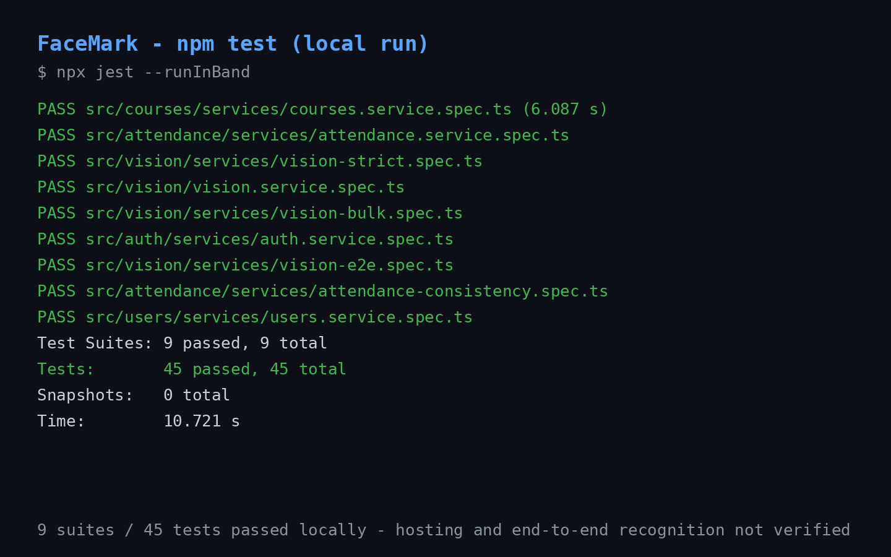

# FaceMark

AI-powered student attendance system using facial recognition. A NestJS REST API connects to a Python FastAPI microservice running DeepFace/TensorFlow for face embedding generation and recognition.

## Why I built it

Attendance is a workflow I know from education projects. I built FaceMark to practice splitting a backend so it stays up when the AI side fails: a typed NestJS API guarded by a hand-written circuit breaker, with a separate Python recognition service that can be swapped or scaled on its own.

## Verified status



- `npm ci` and `npm run build` pass (TypeScript strict).
- 9 Jest suites / 45 tests pass locally (auth, users, courses, attendance, vision).
- Not verified yet: live hosting, a real MySQL instance in production, and end-to-end recognition on real images. Hardening and deployment notes are in [PR #8](https://github.com/ZiadtahaM/FaceMark/pull/8).


## Architecture

```
+---------------------------------------------------------+
|                    CLIENT (Front)                       |
+------------------------+--------------------------------+
                         | HTTP REST
+------------------------v--------------------------------+
|             NestJS API  (Port 3000)                     |
|                                                         |
|  [ Auth ]  [ Users ]  [ Courses ]  [ Attendance ]       |
|                                                         |
|  [ Vision Module + Circuit Breaker ]                    |
+---------------------------+-----------------------------+
                            | HTTP (guarded by circuit breaker)
+---------------------------v-----------------------------+
|          FastAPI AI Service  (Port 8000)                |
|                                                         |
|  DeepFace + TensorFlow face recognition pipeline        |
|  WAL Engine: append-only embedding store                |
|  /upload/batch  /recognize  /health  /embeddings        |
+---------------------------------------------------------+
                            |
                     +------v------+
                     |    MySQL    |
                     +-------------+
```

## Stack

| Layer | Technology |
|-------|------------|
| API | NestJS 10, TypeScript |
| ORM | TypeORM (MySQL) |
| Auth | JWT, Passport, bcrypt |
| AI Service | FastAPI, DeepFace, TensorFlow 2.16, OpenCV |
| Embedding Store | Custom WAL engine (append-only, compaction-safe) |
| Docs | Swagger / OpenAPI (auto-generated) |
| Security | Helmet, express-rate-limit (IP-based, auth endpoints) |
| Resilience | Hand-written circuit breaker — CLOSED/OPEN/HALF_OPEN states with exponential backoff and jitter |
| Deployment | Docker, Render (render.yaml), Cloudflare Workers |

## Modules

```
src/
├── auth/          JWT auth — register, login, refresh token rotation
├── users/         Student and instructor accounts, face embedding storage
├── courses/       Course creation, enrollment management
├── attendance/    Attendance records, session tracking
├── vision/        Face registration (batch), real-time recognition
└── common/
    ├── resilience/  CircuitBreaker — prevents cascade failure to AI service
    ├── interceptors/ LoggingInterceptor, TransformInterceptor
    ├── filters/      HttpExceptionFilter
    └── health/       /health readiness probe

ai-service/
├── app.py          FastAPI server — /upload/batch, /recognize, /health
├── wal_engine.py   Write-Ahead Log for face embedding persistence
└── test_wal_engine.py
```

## Circuit Breaker

The `VisionService` wraps every AI service call in a circuit breaker:

- 3 consecutive failures trip the circuit to **OPEN**
- OPEN state rejects calls immediately with `503` -" no thread pool exhaustion
- After 15s, transitions to **HALF_OPEN** to probe one canary request
- On success, resets to **CLOSED**
- Exponential backoff: `t = random(0, min(8000ms, 500ms × 2^attempt))`

## API Endpoints

| Method | Path | Description |
|--------|------|-------------|
| POST | /api/v1/auth/register | Register student or instructor |
| POST | /api/v1/auth/login | Login, returns JWT |
| POST | /api/v1/vision/register | Upload face images for embedding |
| POST | /api/v1/vision/recognize | Identify student from a frame |
| POST | /api/v1/attendance/mark | Record attendance session |
| GET | /api/v1/attendance/:courseId | Attendance report for a course |
| GET | /health | Liveness probe |
| GET | /api/docs | Swagger UI |

## Local Setup

```bash
# 1. Clone and install NestJS dependencies
npm install

# 2. Configure environment
cp .env.example .env
# Fill: DB_HOST, DB_USERNAME, DB_PASSWORD, DB_NAME, JWT_SECRET, AI_SERVICE_URL

# 3. Start the AI service
cd ai-service
pip install -r requirements.txt
uvicorn app:app --host 0.0.0.0 --port 8000

# 4. Start the NestJS API
npm run start:dev

# Swagger docs at http://localhost:3000/api/docs
```

## Docker

```bash
docker compose up -d
```

## License

MIT - see [LICENSE](LICENSE).
